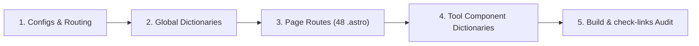

# MyLocationLab — Multi-Language Translation & Localization Roadmap

> **Target Architecture:** Astro 5 SSG &bull; Cloudflare Pages Edge Middleware &bull; Client-Side Privacy (Zero Data Retention)  
> **Current Baseline:** 10 Locales &bull; 48 Routes per Locale &bull; 480 Total Pre-Rendered Pages

---

## 1. Current State (10 Active Locales)

| Code | Language | Native Name | Target Markets | Flag | BCP 47 | Status |
| :--- | :--- | :--- | :--- | :--- | :--- | :--- |
| `en` | English | English | US, UK, Canada, Australia, Global | 🇺🇸 | `en-US` | **Live (Default)** |
| `es` | Spanish | Español | Spain, Mexico, Argentina, Colombia | 🇪🇸 | `es-ES` | **Live** |
| `fr` | French | Français | France, Canada, Belgium, Switzerland | 🇫🇷 | `fr-FR` | **Live** |
| `de` | German | Deutsch | Germany, Austria, Switzerland | 🇩🇪 | `de-DE` | **Live** |
| `pt` | Portuguese | Português | Brazil, Portugal, Angola | 🇧🇷 | `pt-BR` | **Live** |
| `hi` | Hindi | हिन्दी | India | 🇮🇳 | `hi-IN` | **Live** |
| `id` | Indonesian | Bahasa Indonesia | Indonesia | 🇮🇩 | `id-ID` | **Live** |
| `ja` | Japanese | 日本語 | Japan | 🇯🇵 | `ja-JP` | **Live (New)** |
| `it` | Italian | Italiano | Italy, Switzerland | 🇮🇹 | `it-IT` | **Live (New)** |
| `ru` | Russian | Русский | Eastern Europe, Central Asia | 🇷🇺 | `ru-RU` | **Live (New)** |

---

## 2. Future Translation Phases & Target Languages

Languages are prioritized based on **AdSense/Ad RPM tiers**, **monthly geospatial search query volume** ("where am I", "my coordinates", "current address"), and **smartphone/browser penetration**.

### Phase 2: High RPM Developed European & Regional Powerhouses (Priority: High)
*Targeting $15–$35+ AdSense RPM and massive high-intent traffic.*

| Code | Language | Native Name | Key Markets | Population | Primary Search Keyword | Est. RPM Tier |
| :--- | :--- | :--- | :--- | :--- | :--- | :--- |
| `nl` | Dutch | Nederlands | Netherlands, Belgium | ~28M | *waar ben ik*, *mijn locatie* | Tier 1 ($$$$) |
| `pl` | Polish | Polski | Poland | ~40M | *gdzie jestem*, *moja lokalizacja* | Tier 2 ($$$) |
| `tr` | Turkish | Türkçe | Turkey, Cyprus | ~85M | *neredeyim*, *mevcut konumum* | Tier 2 ($$) |
| `sv` | Swedish | Svenska | Sweden, Finland | ~10M | *var är jag*, *min position* | Tier 1 ($$$$) |

### Phase 3: High-Volume East & Southeast Asian Powerhouses (Priority: High)
*High smartphone usage, dense urban centers where rooftop and GPS tools thrive.*

| Code | Language | Native Name | Key Markets | Population | Primary Search Keyword | Est. RPM Tier |
| :--- | :--- | :--- | :--- | :--- | :--- | :--- |
| `ko` | Korean | 한국어 | South Korea | ~52M | *내 위치*, *현재 위치 주소*, *GPS 좌표* | Tier 1 ($$$$) |
| `vi` | Vietnamese | Tiếng Việt | Vietnam | ~100M | *vị trí của tôi*, *tọa độ GPS* | Tier 2 ($$) |
| `th` | Thai | ไทย | Thailand | ~70M | *ตำแหน่งของฉัน*, *พิกัด GPS* | Tier 2 ($$) |
| `zh-TW`| Traditional Chinese | 繁體中文 | Taiwan, Hong Kong | ~32M | *我的位置*, *經緯度查詢*, *現在位置* | Tier 1 ($$$$) |
| `zh-CN`| Simplified Chinese | 简体中文 | Global Chinese Diaspora, SG, MY | ~1.4B | *我的位置*, *经纬度查询*, *当前位置* | Tier 2 ($$) |
| `tl` | Filipino / Tagalog | Tagalog | Philippines | ~115M | *nasaan ako*, *aking lokasyon* | Tier 3 ($) |

### Phase 4: Nordic & Central European High-Value Markets (Priority: Medium)
*Smaller population size, but among the highest RPM and tech adoption worldwide.*

| Code | Language | Native Name | Key Markets | Population | Primary Search Keyword | Est. RPM Tier |
| :--- | :--- | :--- | :--- | :--- | :--- | :--- |
| `no` | Norwegian | Norsk | Norway | ~5.5M | *hvor er jeg*, *min posisjon* | Tier 1 ($$$$) |
| `da` | Danish | Dansk | Denmark | ~6M | *hvor er jeg*, *min placering* | Tier 1 ($$$$) |
| `fi` | Finnish | Suomi | Finland | ~5.5M | *missä olen*, *sijaintini* | Tier 1 ($$$$) |
| `cs` | Czech | Čeština | Czech Republic | ~10.5M | *kde jsem*, *moje poloha* | Tier 2 ($$$) |
| `ro` | Romanian | Română | Romania, Moldova | ~22M | *unde mă aflu*, *locația mea* | Tier 2 ($$) |
| `hu` | Hungarian | Magyar | Hungary | ~10M | *hol vagyok*, *pontos helyzetem* | Tier 2 ($$) |
| `el` | Greek | Ελληνικά | Greece, Cyprus | ~11M | *πού βρίσκομαι*, *οι συντεταγμένες μου* | Tier 2 ($$$) |
| `uk` | Ukrainian | Українська | Ukraine, Diaspora | ~40M | *де я знаходжуся*, *моє місцезнаходження* | Tier 3 ($) |

### Phase 5: South & Southeast Asian Regional Giants (Priority: Medium)
*Massive volume growth and mobile adoption.*

| Code | Language | Native Name | Key Markets | Population | Primary Search Keyword | Est. RPM Tier |
| :--- | :--- | :--- | :--- | :--- | :--- | :--- |
| `ms` | Malay | Bahasa Melayu | Malaysia, Brunei, Singapore | ~33M | *di mana saya*, *lokasi saya* | Tier 2 ($$) |
| `bn` | Bengali | বাংলা | Bangladesh, India (WB) | ~270M | *আমার বর্তমান অবস্থান*, *জিপিএস স্থানাঙ্ক* | Tier 3 ($) |
| `ta` | Tamil | தமிழ் | India, Sri Lanka, Singapore | ~85M | *என் தற்போதைய இருப்பிடம்* | Tier 3 ($) |
| `te` | Telugu | తెలుగు | India (AP/TS) | ~90M | *నా ప్రస్తుత స్థానం* | Tier 3 ($) |
| `mr` | Marathi | मराठी | India (MH) | ~85M | *माझे सध्याचे स्थान* | Tier 3 ($) |

### Phase 6: Right-to-Left (RTL) Languages (Requires RTL Layout Mode)
*Significant search volume in GCC and North Africa; requires CSS `dir="rtl"` support.*

| Code | Language | Native Name | Key Markets | Population | Primary Search Keyword | Est. RPM Tier |
| :--- | :--- | :--- | :--- | :--- | :--- | :--- |
| `ar` | Arabic | العربية | Saudi Arabia, UAE, Egypt, MENA | ~400M | *أين أنا الآن*, *موقعي الحالي*, *إحداثيات GPS* | Tier 1–2 ($$$) |
| `he` | Hebrew | עברית | Israel | ~9M | *איפה אני*, *מיקום נוכחי* | Tier 1 ($$$$) |
| `fa` | Persian / Farsi | فارسی | Iran, Afghanistan | ~80M | *موقعیت مکانی من*, *مختصات جی پی اس* | Tier 3 ($) |

---

## 3. Step-by-Step Translation Checklist for New Batches

When adding a new batch of languages (e.g. `nl`, `pl`, `tr`, `sv`), follow this proven checklist:

### 1. Global Configurations
- [ ] **`astro.config.mjs`**: Add new locale codes to `i18n.locales`, `i18n.fallback`, and `sitemap.i18n.locales`.
- [ ] **`src/i18n/config.ts`**:
  - Add to `SUPPORTED_LANGS` array and `SupportedLang` union type.
  - Define language metadata in `languages` object (name, flag, BCP 47 code, text direction `'ltr'` or `'rtl'`).
  - Update `localizeHtml` regular expression to include the new language codes.
- [ ] **`functions/_middleware.js`**: Update Cloudflare Edge redirect regex pattern.
- [ ] **`scripts/check-links.mjs`**: Update `getLocale()` array so the link crawler recognizes the new routes.

### 2. Navigation & Hub Data
- [ ] **`src/data/navigation.js`**: Add translations for all 32 navigation keys in `localizedNavLabels`.
- [ ] **`src/data/toolFaqs.ts`**: Add language entry in `toolFaqTitles`.

### 3. Global Translation Dictionaries (`src/i18n/*.ts`)
Populate the new language keys across all 14 dictionary files:
- [ ] `ui.ts` (84 UI keys)
- [ ] `home.ts`
- [ ] `myLocation.ts`
- [ ] `toolsPage.ts`
- [ ] `mapsPage.ts`
- [ ] `shareLocation.ts`
- [ ] `comparisonsHub.ts`
- [ ] `guidesHub.ts`
- [ ] `faqPage.ts`
- [ ] `glossaryPage.ts`
- [ ] `aboutPage.ts`
- [ ] `contactPage.ts`
- [ ] `privacyPage.ts`
- [ ] `termsPage.ts`

### 4. Page Routes (48 static `.astro` files per language)
Create directory `src/pages/<lang>/` mirroring the structure:
- Root files: `index.astro`, `404.astro`, `sitemap.astro`, `location.astro`, `gps.astro`, `coordinates.astro`, `latitude-longitude.astro`, `address.astro`, `city.astro`, `state.astro`, `country.astro`, `ip.astro`, `maps.astro`, `share-location.astro`, `about.astro`, `contact.astro`, `editorial-policy.astro`, `privacy.astro`, `terms.astro`, `disclaimer.astro`, `faq.astro`, `glossary.astro`
- Subdirectories:
  - `tools/` (11 pages: index + 10 tools)
  - `guides/` (11 pages: index + 10 guides)
  - `comparisons/` (4 pages: index + 3 comparisons)

### 5. Interactive Tool Components (`src/components/tools/`)
Add localized dictionaries to the 10 core tool views:
- [ ] `AddressFinderView.astro`
- [ ] `GpsCoordinatesView.astro`
- [ ] `LatitudeLongitudeView.astro`
- [ ] `CoordinateConverterView.astro`
- [ ] `DistanceCalculatorView.astro`
- [ ] `ElevationFinderView.astro`
- [ ] `GeocodingView.astro`
- [ ] `ReverseGeocodingView.astro`
- [ ] `LocationQrCodeView.astro`
- [ ] `GpsAccuracyView.astro`

### 6. Verification & Quality Gates
- [ ] Run `npm run build`: Verify all pages compile without warnings or errors.
- [ ] Run `node scripts/check-links.mjs`:
  - **Broken links**: MUST BE `0`.
  - **Cross-locale leaks**: MUST BE `0`.
  - **Orphan pages**: MUST BE `0`.

---

## 4. Special Considerations for RTL Languages (Arabic, Hebrew, Persian)

When implementing Phase 6:
1. **HTML Document Direction**: In [src/layouts/BaseLayout.astro](file:///Users/lakhandewangan/ToolSites/MyLocation/src/layouts/BaseLayout.astro), ensure `<html lang={lang} dir={languages[lang]?.dir || 'ltr'}>`.
2. **CSS Logical Properties**:
   - Prefer `margin-inline-start` / `margin-inline-end` over `margin-left` / `margin-right`.
   - Prefer `padding-inline-start` / `padding-inline-end` over `padding-left` / `padding-right`.
   - Ensure chevron icons and back-arrows invert horizontally (`transform: scaleX(-1)`).
3. **Map Controls**: Leaflet navigation controls remain standard, but data overlays and popup cards should respect text direction.

